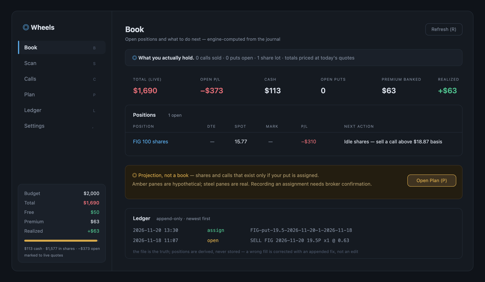

<div align="center">


# Wheels Strategy

**Sell puts. Get assigned. Cover the shares. Keep the receipts.**

A local-first desk for the wheel strategy: a cash-secured put scanner reading live
Yahoo option chains, an append-only trade journal that *derives* your positions, a
web UI and a TUI over the same engine, and a ready-made local AI agent that can read
your book but cannot cook its numbers.




</div>

---

## The problem

The wheel is simple to describe and miserable to track. You sell a cash-secured put;
if it's assigned you own 100 shares and your collateral became stock; then you sell
covered calls until they're called away; then you sell puts again. Four screens, three
spreadsheets, and — this is the part that actually bites — **a capital model your tools
get wrong**:

- Spreadsheets count collateral released at assignment as if the cash came back. It
  didn't; it bought stock. Now you can "afford" a new put you cannot actually secure.
- Broker apps mix what you *hold* with what you *could sell*. A list of call options
  that are only covered *if the put is assigned* looks identical to a list of calls
  you can sell right now.
- Generic chat advice doesn't know your book, your basis, or your remaining cash —
  and wiring a real assistant to real numbers usually means pasting numbers into a
  chat by hand, or worse, trusting the model's arithmetic.

Wheels Strategy is the honest version: one journal file, one engine, and every pane
saying out loud whether a number is **real** or a **projection**.

## The wheel, as the machine sees it

```
        ┌────────────────────────────────────────────────────────┐
        │                        your budget                     │
        └────────────────────────────────────────────────────────┘
                             │
        sell cash-secured put│  collateral = strike × 100 × contracts
                             ▼
                      ┌─────────────┐   expires worthless   ┌──────────────┐
                      │  put open   │ ────────────────────► │ keep premium │──┐
                      └─────┬───────┘                       └──────────────┘  │
                            │ assigned (spot ≤ strike)                        │
                            ▼                                                 │
                   buy 100 shares @ strike ◄── collateral converts to stock   │
                            │                       (capital stays out)       │
                            ▼                                                 │
                    ┌──────────────┐  sell covered call  ┌─────────────────┐  │
                    │ shares held  │ ──────────────────► │ call open       │  │
                    └──────────────┘                     └───────┬─────────┘  │
                            ▲                        called away │  expires   │
                            │                        + strike    │  (keep     │
                            └──────────────────────◄─────────────┤  shares)   │
                                     capital comes home          ▼            │
                                                    repeat ◄──── (premium) ◄──┘
```

Every box is an *event* in the journal. The positions table you see is derived by
replaying the file. Nothing is stored twice, so nothing can disagree with itself.

## How it works

### The file is the truth

`state/trades.jsonl` — one JSON event per line, append-only, yours to `cat`:

```json
{"type": "open",   "symbol": "FIG", "kind": "put", "strike": 19.5, "expiry": "2026-11-20", "contracts": 1, "premium": 0.63, "id": "FIG-put-19.5-..."}
{"type": "assign", "parent": "FIG-put-19.5-..."}
```

Seven event types — `open, close, expire, assign, called_away, roll, fix` — replay into
open shorts, share lots, realized P/L, and warnings for anything inconsistent. A bad
entry is corrected by appending, never by editing history. The journal is gitignored;
this repo ships code, not your trades.

### The money math

The model that spreadsheets get wrong is stated as an identity and tested:

```
committed     = open-put collateral + shares held at cost
free cash     = budget − committed                  ← what can secure a NEW put
total (cost)  = budget + realized P/L               = cash + collateral + shares at cost
total (live)  = cash + collateral + shares × spot   = total (cost) + unrealized
```

Assignment does not free your cash — it *moves* it from collateral into stock. Only
when shares leave (called away) does capital come home. The sidebar shows all of it at
once, marked to live quotes wherever quotes are loaded, falling back to cost when a
symbol has no price — the book never invents a number:

```
Budget    $2,000        $113 cash · $1,577 in shares · −$373 open
Total     $1,690
Free      $50
```

`Free` and `Total` are deliberately different animals: free is capital you may still
*pledge* within your own budget; total is what the account is *worth* if it all ended
today. Banked premium raises total, not free — if you want premiums compounding into
new positions, that's a budget edit, not a silent reclassification.

### Actuals: editing what you really got

Derived numbers assume idealized fills — shares arrive at exactly the strike, the
premium you typed is what you received. Reality has pin risk, partial assignment,
commissions. A `fix` event carries **actual values** that override the derivation on
every later replay, with the original ticket left intact underneath:

| Field | Meaning |
|---|---|
| `premium` `strike` `expiry` `contracts` | the ticket itself |
| `cost` | per-share price you **really paid** when a put was assigned |
| `shares` | shares you **really received** (pin risk, partial assignment) |
| `price` | per-share price you **really got** when shares were called away |

```sh
wheel --json fix --parent "FIG 2026-11-20 19.5P" --set '{"cost": 19.42, "shares": 90}'
```

Collateral, basis, committed, free cash, cash, realized and the totals all recompute
from the truth, and the fix response carries the fresh book so no screen can lag it.

### Real vs. projected: one grammar everywhere

The panes speak two languages and mark them without ambiguity — steel for **what you
hold**, amber for **what doesn't exist yet**:

| Pane | Mode | It says |
|---|---|---|
| Book | real | your open positions with live marks |
| Scan (default) | real | ranked puts sized against actual free cash |
| Scan (project) | amber | *"Projected ranking — not capacity"* against the full budget |
| Plan | amber | *"Projection, not a book"* — shares/calls that appear **if** assigned |
| Calls | real | sellable candidates, sized only to **unpledged** shares you hold |

The rules are load-bearing in code, not just CSS: candidates in Calls are capped by
`shares − shares already pledged to calls you sold`, so the app can never offer you a
second call over the same 100 shares; opening a call without shares behind it is
allowed but **loud** ("This call is not covered: 0 of 1 contract(s)…"); and every JSON
payload carries `"mode": "actual" | "projection"` so the AI agent inherits the same
distinction instead of guessing. A covered call is *collateralized by the stock*, so
your cash budget never gates call strikes — only shares size them.

### The scanner

`scan` pulls the option chains for your watchlist inside the DTE window and runs
gates first, scores second. A contract failing a gate is *excluded and counted*, and
the empty result quotes its own `rejected_reasons` — silence is not an answer:

| Gate | Default | Key |
|---|---|---|
| open interest | ≥ 100 | `min_open_interest` |
| bid/ask spread | ≤ 15% of mid | `max_spread_pct` |
| delta band | by profile (conservative 0.10–0.22 … aggressive 0.25–0.45) | `profile` |
| collateral | ≤ free cash | `budget` |

The 100-point score weights annualized yield, downside cushion, IV vs realized vol,
liquidity and trend — weights shift with the risk profile
([full table](.opencode/skills/wheel-strategy/references/scoring.md)). Flags carry the
judgement calls: `earnings before expiry`, `ex-div … early-assignment risk`,
`falling knife`, `near 52-week low`, `IV much richer than realised`. Deltas come from
Black-Scholes computed in [`wheel/bsm.py`](wheel/bsm.py) — stdlib math, no numeric
dependency.

## Install

Requires [uv](https://docs.astral.sh/uv/) and Python 3.12+. No accounts, no database,
no build step — the web frontend is hand-written JavaScript served straight from disk.

```sh
git clone https://github.com/sambitar/wheels-strategy.git
cd wheels-strategy
uv sync
uv run wheel --web          # the desk → http://127.0.0.1:8765
uv run wheel                # or the Textual TUI, same engine
```

To get a global `wheel` command (what the OpenCode agent calls):

```sh
uv tool install --editable .
wheel --web --port 8765 --no-browser
```

First run: open **Settings**, set your `budget` and watchlist, then **Scan**.

## The OpenCode connection

This repo ships a complete local-AI setup under `.opencode/` — open the project with
[OpenCode](https://opencode.ai) and a strategy analyst agent exists, with your journal
as its context. Nothing talks to anyone else: the agent reads the same engine the UI
does, and every number it quotes came from code, not from the model's head.

```
.opencode/
├── opencode.json                     project config: allow `uv run wheel*` in the shell
├── agents/wheels.md                  the subagent: persona, model, hard permissions
└── skills/wheel-strategy/
    ├── SKILL.md                      the workflow the agent loads on demand
    └── references/scoring.md         gates, weights, delta bands, action rules
```

**The agent** ([`agents/wheels.md`](.opencode/agents/wheels.md)) is a `mode: subagent`
whose whole value is its permission list:

```yaml
model: deepseek/deepseek-flash#high   # ← change to whatever provider you use
permissions:
  - { action: edit,  resource: "*",             effect: deny }   # cannot touch files
  - { action: shell, resource: "*",             effect: deny }   # cannot run anything…
  - { action: shell, resource: "uv run wheel*", effect: allow }  # …except the engine
  - { action: shell, resource: "wheel --json*", effect: allow }
```

It can *analyse* through the JSON API and cannot *forge* numbers: no edits, no Python
REPL, no curl to "get better data". Ask your primary agent *"what should I sell this
month?"* and let it delegate to `wheels` (or switch to the agent directly with
<kbd>Tab</kbd>); it will run `uv run wheel --json status && scan`, reason about
cushion vs yield vs flags, and answer in the fixed format the skill defines:
**Pick · Why · Ticket · If assigned · Risk · Passed** — plus the standing disclaimer
*"Not financial advice — verify with your broker before trading."*

**The skill** ([`SKILL.md`](.opencode/skills/wheel-strategy/SKILL.md)) encodes the
rules this project had to learn the hard way, e.g. *the engine is the source of truth —
your job is judgement, never arithmetic*; *`candidates` is already ranked and gated —
do not re-sort it*; *Plan is projection: never present a projected call as sellable
today*; *when a reported fill differs from the book, offer a `fix` rather than arguing
about math*; *journal writes only when the user asks explicitly, and `sync --apply`
needs per-proposal confirmation*.

**Journal writes stay interactive** — the CLI exposes them (`open / close / expire /
assign / called_away / roll / fix`), and you either use the web desk (every write has a
confirmation dialog) or tell the agent to do it out loud.

## Interface

The engine has three front doors and they return identical numbers.

| CLI (`uv run wheel --json …`) | Result |
|---|---|
| `status` | open positions, live marks, one next-action each, marked book |
| `scan [--symbols FIG,SOFI] [--cash 2000]` | ranked puts; `--cash` projects |
| `calls` / `plan` | sellable now / what-if-assigned (both carry `mode`) |
| `journal` | raw events, derived P/L, warnings |
| `sync` → `sync --apply` | classify expired positions: preview, then confirm |
| `open --symbol … --strike …` and friends | record trades; see `--help` |

| HTTP (same shapes) | |
|---|---|
| `GET /api/{book,status,scan,calls,plan,journal,settings,sync}` | reads |
| `POST /api/trades/{open,close,expire,assign,called-away,fix}` | writes |
| `POST /api/{settings,sync}` | config, confirmed sync |

The desk server binds `127.0.0.1` by default. `--host 0.0.0.0` is opt-in and prints a
warning, because **the web UI has no authentication** — anyone who can reach the port
can record trades.

Keyboard: the same single keys everywhere — <kbd>B</kbd> Book · <kbd>S</kbd> Scan ·
<kbd>C</kbd> Calls · <kbd>P</kbd> Plan · <kbd>L</kbd> Ledger · <kbd>,</kbd> Settings ·
<kbd>R</kbd> refresh · <kbd>X</kbd> toggle projection (TUI) · click everything (web).

## Configuration

Everything lives in [`config.toml`](config.toml) and the Settings screen writes the
same file back in place:

| Key | Default | Meaning |
|---|---|---|
| `account.budget` | — | total capital willing to be committed (positions, not cash) |
| `account.profile` | `balanced` | delta bands + score weights |
| `scan.dte_min` / `dte_max` | `30` / `60` | expiry window, days |
| `scan.min_open_interest` | `100` | liquidity gate |
| `scan.max_spread_pct` | `15` | liquidity gate, % of mid |
| `scan.risk_free_rate` | `0.04` | for Black-Scholes delta |
| `scan.top_n` | `8` | candidates returned |
| `watchlist.symbols` | — | tickers scanned |

## Project layout

```
wheel/
├── bsm.py        Black-Scholes delta/greeks — stdlib math only
├── market.py     ALL Yahoo access (yfinance); swap providers here, nowhere else
├── score.py      gates, weights, flags, covered-call sizing, next-action rules
├── ledger.py     append-only journal, replay/derivation, fixes (actual values)
├── engine.py     headless commands — the single source of truth for all UIs
├── cli.py        wheel / --web / --json entrypoints
├── app.py + ui/  Textual TUI (screens, modals, theme)
└── web/          stdlib http.server + hand-written frontend
    ├── server.py routes, validation, id-or-label resolution
    └── static/   index.html, app.js, views.js, modals.js, style.css
tests/            117 tests: bsm, scoring, journal replay & fixes, web transport, TUI flows
.opencode/        the agent, the skill, the permission boundary
```

There is exactly one implementation of every number. The TUI, the web desk and the
agent call the same functions, which is how "the screen is lying" became a testable
claim instead of a vibe.

## Privacy and safety

- **Your trades stay on disk, yours.** `state/` is gitignored; nothing is uploaded.
  Market data is fetched from Yahoo endpoints via `yfinance` — treat it as *delayed
  and unofficial*, and verify every ticket at your broker.
- **The model sees only what you let it.** The bundled agent's shell is confined to
  `wheel --json` output; its provider/endpoint is whatever OpenCode is configured
  with — local models keep that promise, hosted ones carry the usual caveats.
- **No authentication on the desk.** Loopback-only by default for exactly this reason.
- **Nothing here is financial advice.** Options selling carries unlimited downside on
  naked legs; the wheel's "safety" assumes you can survive assignment. This software
  counts your money honestly. Deciding whether you should be risking it is still on you.

## Known limits

| Limit | Detail |
|---|---|
| One wallet, one currency | budget/cash are single-account numbers, no multi-broker rollup |
| Quotes are unofficial | Yahoo chains, occasionally stale or wrong; `market.py` is the seam |
| Shares marked at last price | no intraday interpolation; `/api/book` alone is at cost until a view loads quotes |
| Premium banks on close | realized is booked when a position finishes, not on fill — conservative by design |
| No dividend modelling | assignment economics ignore accrued dividends |
| Some tests hit the network | quote-dependent tests skip nothing; they tolerate failure but expect speed |
| No mobile story | it's a terminal and a web page |

## Tests

```sh
uv run pytest -q      # 117 passing
```

The suite is mostly about the things that silently ruin a tracker: the full-wheel cash
identity (open → assign → cover → called away must return every dollar to the right
bucket), fixes recomputing the whole book, replay refusing to double-count premium,
label-vs-id resolution, and real keypresses driving the TUI.

## Troubleshooting

**No candidates and I have free cash.** Read `rejected_reasons` in the response (the
table footer shows them too) — usually the delta band or OI gate. Widen with `profile`
or the DTE window before blaming the scanner.

**"No free cash" but a put expired.** Recording is manual: `sync` classifies expired
positions from the closing price and *previews*; apply it and the book reconciles.

**Wrong numbers after importing past trades.** That's usually an actuals problem —
`fix` the fill prices. Check `journal` for `warnings`: an event with an unknown parent
means a typo'd id.

**Port 8765 busy.** `wheel --web --port 8899`.

**The agent won't write to the journal.** By design: writes need you. Ask it to show
the exact `uv run wheel --json …` command and run it, or use the desk.

## Roadmap

- [ ] Broker CSV import (match fills to journal events, propose fixes automatically)
- [ ] IV rank / volatility regime from stored history
- [ ] Rolling suggestions with real premium-difference quotes
- [ ] Weekly digest: fills, roll-ups, mark-to-market delta over time
- [ ] Expired-position sync on a timer, confirmation still manual
- [ ] Configurable premium crediting (let banked premium compound into free cash)

## Contributing

Issues and PRs welcome. The rules of the house: the engine owns every number (UIs
render, they don't compute); the journal stays append-only; anything that mixes real
and projected must say which is which; a new claim gets a test that would have caught
the last bug it resembles.

## License

[MIT](LICENSE) © 2026 Reshd Bitar
